# Restaurant Reviews

A restaurant review platform with two kinds of accounts:

- **Reviewers** browse every restaurant, filter and sort the list, open a restaurant's page, and write, edit and delete
  their own reviews.
- **Restaurant owners** create, edit and delete their own restaurants (with a photo) and read the reviews those
  restaurants receive.

It's a single-page React app backed by an ASP.NET Core API and a PostgreSQL database. Sign-in is required for everything
except the sign-in and registration pages.

| Document | Contents |
|---|---|
| [requirements.txt](requirements.txt) | Product requirements, answered design questions (Q1–Q15), acceptance checklist, build progress |
| [data-model-and-api.txt](data-model-and-api.txt) | Database tables, API endpoints, filter and sorting rules, request and response shapes |
| [acceptance.txt](acceptance.txt) | Acceptance criteria, and each one checked in the app with screenshots from [screenshots/](screenshots/) |
| [deploy/README.md](deploy/README.md) | AWS deployment: architecture, setup steps, task definition and IAM policies |

## High-level design

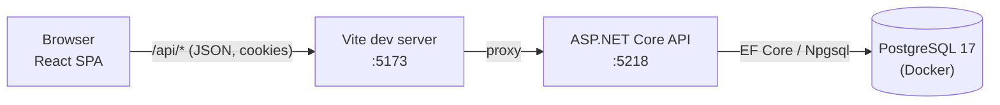

The app is designed to be served from the same origin as the API, so cookies are first-party and no CORS setup is needed.
In development, Vite serves the React app and forwards `/api` requests to the API. In production, the API serves the
React build itself from one Docker image; see [Deploying to AWS](#deploying-to-aws).

### Frontend: `client/`

React 19 with TypeScript, Vite, Material UI and React Router.

- **Routing:** client-side only, so moving around the app never reloads the page. `/` shows the reviewer's restaurant
  list or the owner's "My restaurants", depending on the signed-in role. Other routes are `/restaurants/:id`,
  `/restaurants/new`, `/restaurants/:id/edit`, `/login` and `/register`.
- **Route guards:** `RequireAuth` sends signed-out users to sign-in and returns them to the page they wanted afterwards.
  `RequireRole` shows "Page not found" to a reviewer who opens an owner-only page.
- **API access:** every request goes through one wrapper (`src/api/client.ts`). It adds the CSRF header to requests that
  change data, turns server errors into readable messages, and maps per-field validation errors onto form fields.
- **State:** the signed-in user lives in `AuthProvider`. Restaurant-list filters are kept in the URL and saved to
  `localStorage` per account; review filters are kept in the URL only.

### Backend: `server/RestaurantReviews.Api/`

.NET 10, ASP.NET Core controllers, EF Core with the Npgsql provider.

| Area | How it works |
|---|---|
| Controllers | `Auth`, `Cuisines`, `Restaurants` and `Reviews`, all under `/api` |
| Accounts | ASP.NET Core Identity. Each user has a display name and a fixed role, stored as a claim in the sign-in cookie. |
| Access control | A fallback policy requires sign-in on every endpoint unless it's marked public. Role checks use `[Authorize(Roles = …)]`; ownership and authorship are checked against the signed-in user's ID, never an ID sent in the request. |
| CSRF | `GET /api/auth/csrf` issues a token cookie; a global filter rejects any `POST`, `PUT` or `DELETE` whose `X-XSRF-TOKEN` header doesn't match it. |
| Errors | Error responses use `ProblemDetails`; validation errors list messages per field. |
| Database | EF Core migrations in `Data/Migrations`, snake_case table and column names. Average ratings, filtering, sorting and paging all run in the database, not in C#. |

### Data model

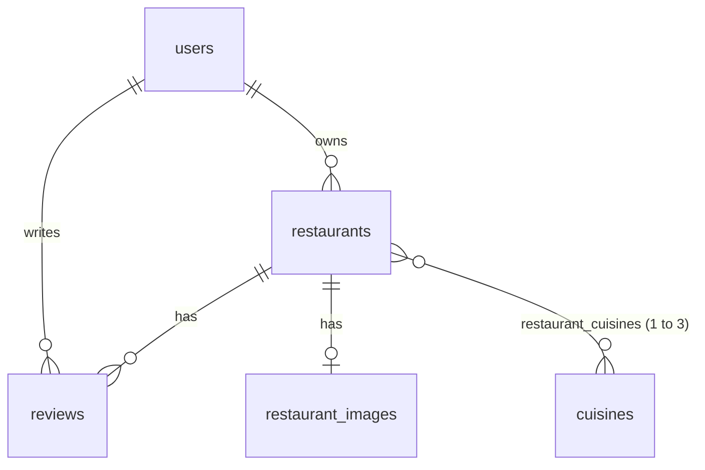

Restaurant images are stored in PostgreSQL in their own table, so loading a restaurant doesn''t load its image bytes (the image is requested separately), and
the database is the only thing to back up. Deleting a restaurant deletes its reviews, cuisines links and image with it.
Full details are in [data-model-and-api.txt](data-model-and-api.txt).

## Product considerations

### Accounts and access

- **One role per account, fixed at registration.** Each email address can register once, ignoring case. Someone who wants
  to be both a reviewer and an owner currently needs two email addresses.
- **Sign-in is required to browse.** Signed-out users only see the sign-in and registration pages.
- **Owners see only their own restaurants.** They can't browse other owners' restaurants and can't write reviews, even on
  their own. Another owner's restaurant answers **404**, the same as one that doesn't exist, so its existence isn't
  revealed.
- **Sessions:** an `httpOnly` cookie that expires after 7 days without use. An account locks for 5 minutes after 5 wrong
  passwords. An unknown email and a wrong password get the same "Incorrect email or password." message. Registration
  ("An account with this email already exists.") and the lockout message do still reveal that an email is registered.
- **Blocked cookies:** sign-in needs cookies, so the app detects when they're blocked and asks the user to enable them.

### Ratings and reviews

- Ratings are whole stars from 1 to 5; review text is optional, up to 2,000 characters.
- A reviewer can post **more than one review** for the same restaurant, and reviews publish immediately with no
  moderation. Known limitation: one reviewer can skew a restaurant's average.
- Only a review's author can edit or delete it. Owners can read and filter reviews on their restaurants but can't change
  them.
- **Average rating** is rounded to 2 decimals in the database, and that same rounded value is shown, filtered on and sorted
  by. A restaurant showing "4.00" therefore always matches "minimum 4".
- The average and review count always cover **all** of a restaurant's reviews, whatever review filters are applied; the
  list says "Showing 3 of 12 reviews".

### Unrated restaurants and sorting

- Restaurants with no reviews show **"No reviews"** instead of a rating.
- They come **last** in both sort orders, so "lowest rated first" doesn't open with restaurants nobody has rated.
- They're **hidden** as soon as any rating filter is set, since they have no rating to compare.
- Equal ratings are ordered by title, then ID, so the order never changes between page loads.

### Filtering, search and preferences

- **Restaurant list:** keyword search over title, location and description; one or more cuisines; minimum and/or maximum
  rating (decimals, both inclusive); sort highest or lowest rated first (highest is the default). Pages of 12.
- **Multiple cuisines mean "all of them":** Italian + Japanese shows only restaurants tagged with both.
- **Remembered per account:** the restaurant list's filters and sort are saved in the browser for each account and restored
  when the reviewer returns, including after signing out and back in. The page number isn't remembered.
- **Reviews:** keyword, rating range and date range filters; sort by newest, oldest, highest or lowest rating. Pages
  of 10. These start cleared on each restaurant but stay in the URL, so refresh, Back and shared links keep them.

### Restaurants and images

- **Cuisines come from a fixed list** (Italian, French, Chinese, Japanese, Indian, Mexican, Greek), not free text, so
  filter values stay consistent. Each restaurant has 1 to 3.
- **Field limits:** title 100, location 200, description 2,000 characters; all required. The browser and the server
  both validate, and errors appear next to the field concerned.
- **Images are uploaded, not linked.** JPG, PNG or WebP, up to 5 MB. The server checks the file's actual content, not just
  its name. Without an image, a default picture is shown.
- **One click, one request:** the image travels as base64 inside the create or edit request, so a restaurant and its
  image save together or not at all. Picked images are previewed locally before saving.
- **Image URLs change when the image does** (`…/image?v=<image id>`), so browsers never show a cached old photo.
- **Deleting a restaurant** asks for confirmation, then permanently deletes its reviews and image too.

## Key screens

### Sign in and register

| Sign in | Registration with validation errors |
|---|---|
| 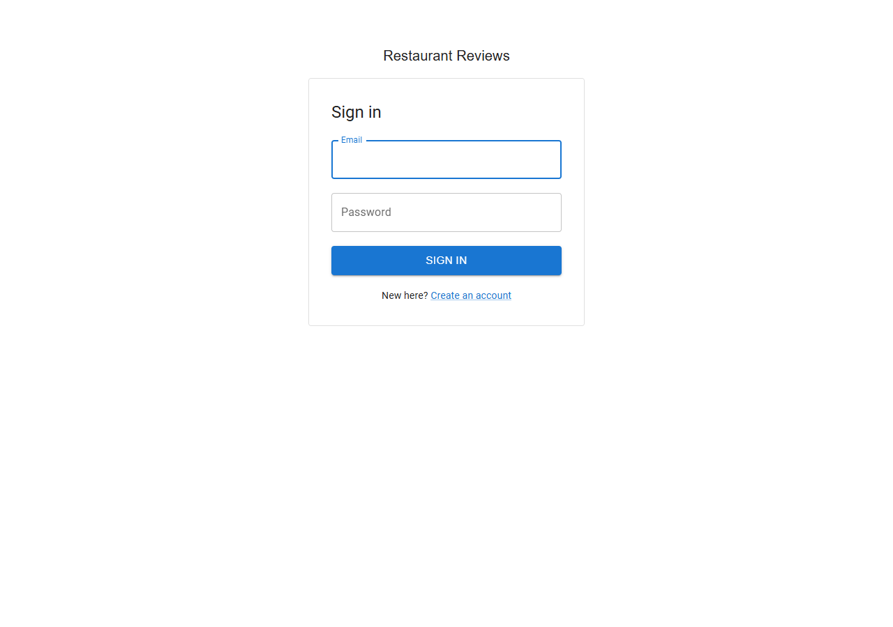 | 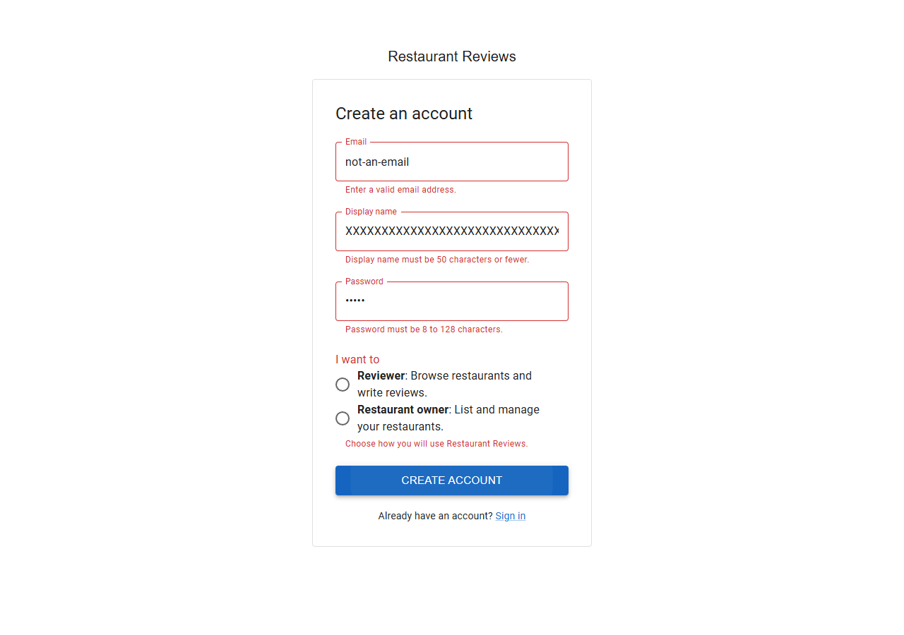 |

### Reviewer: restaurant list

The reviewer's home page: restaurant cards with image, cuisines, location and rating, plus the filter bar. Unrated
restaurants are listed last.

| Default list, highest rated first | Italian with a minimum rating of 4 |
|---|---|
| 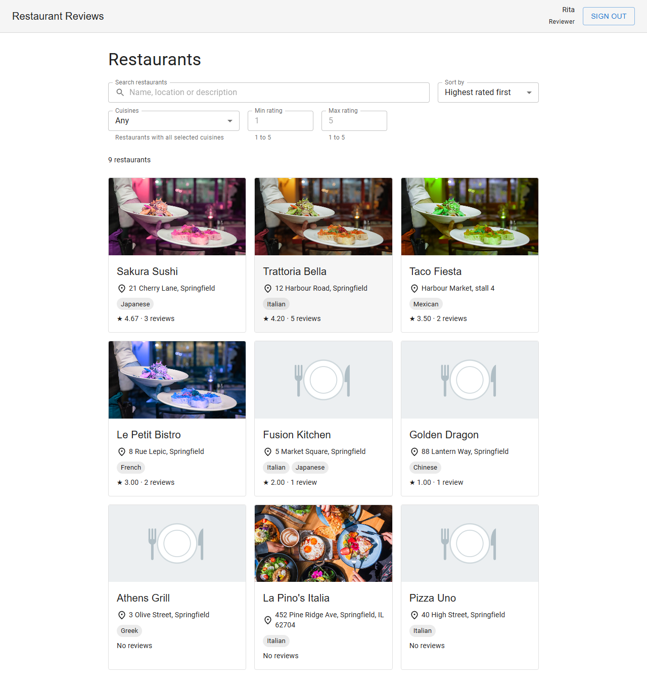 | 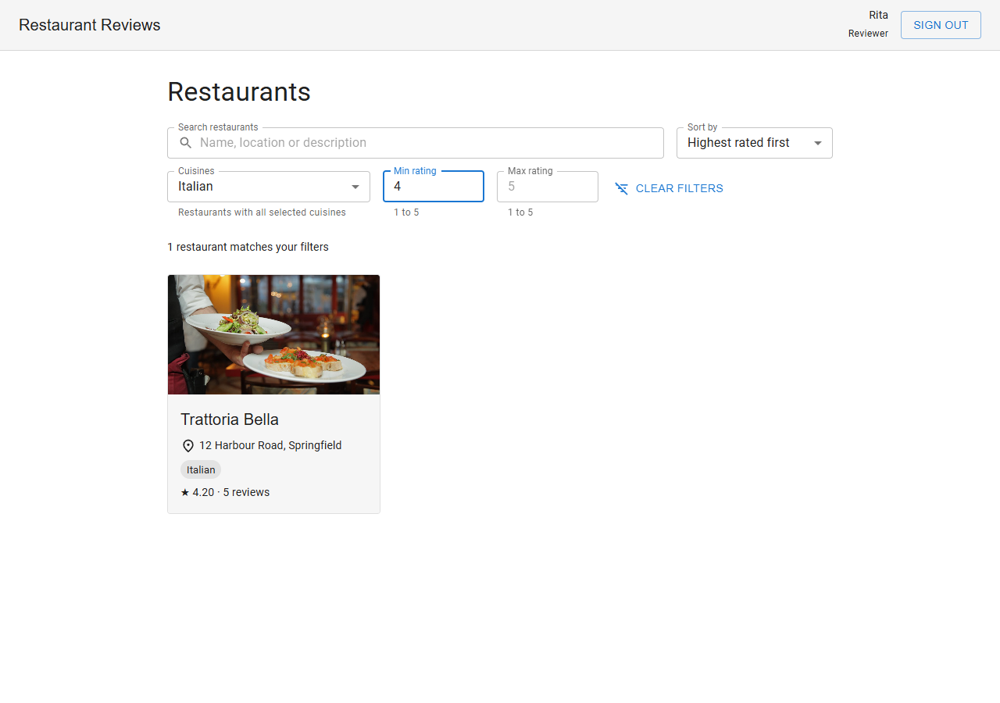 |

### Reviewer: restaurant page and reviews

| Restaurant details | Edit and delete only on your own reviews |
|---|---|
| 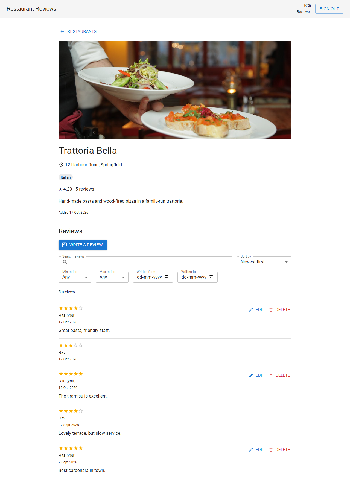 | 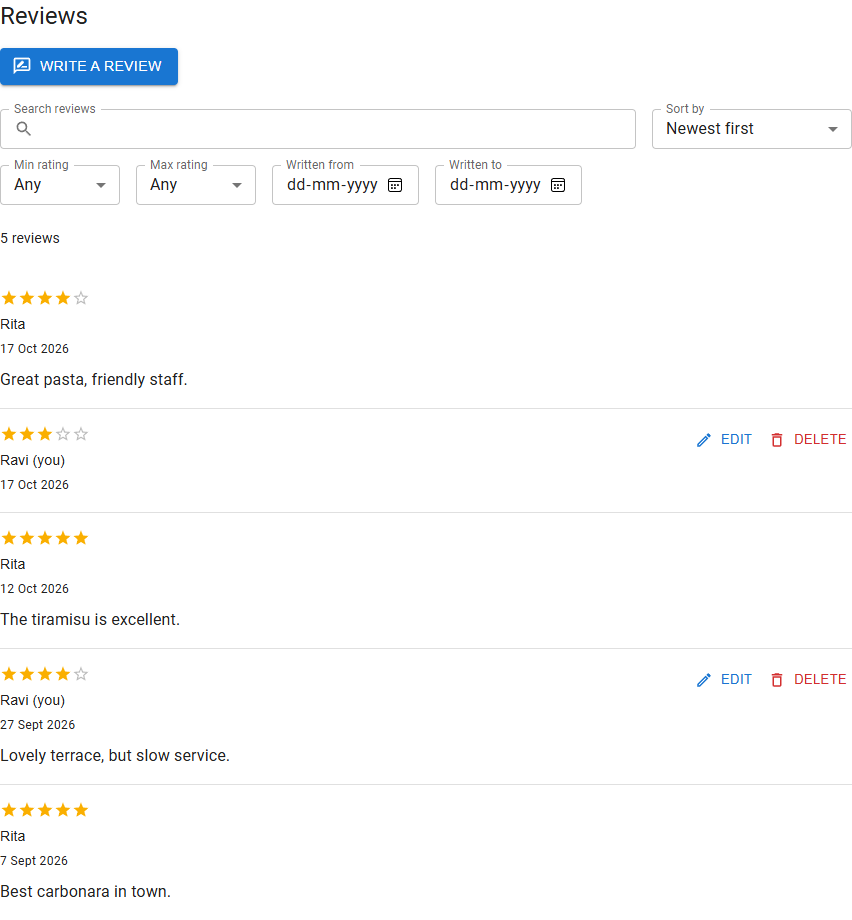 |

### Owner: my restaurants

The owner's home page lists only their own restaurants, newest first.

| My restaurants | Edit form with image |
|---|---|
| 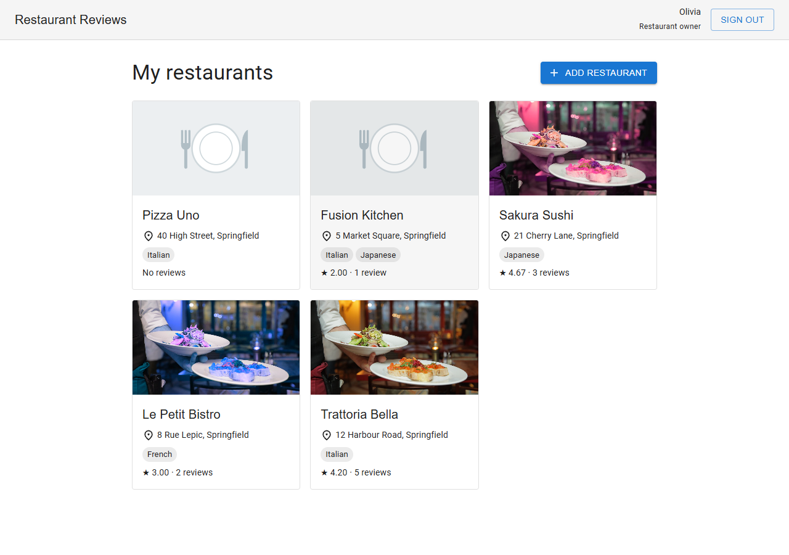 | 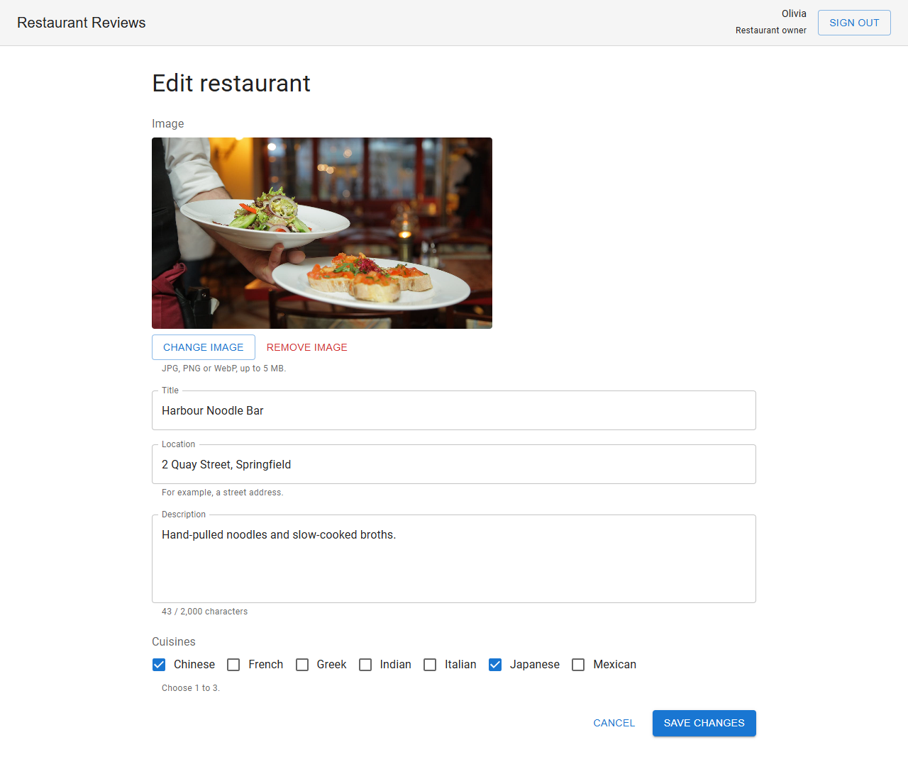 |

| Owner filtering reviews on their restaurant | Delete confirmation |
|---|---|
| 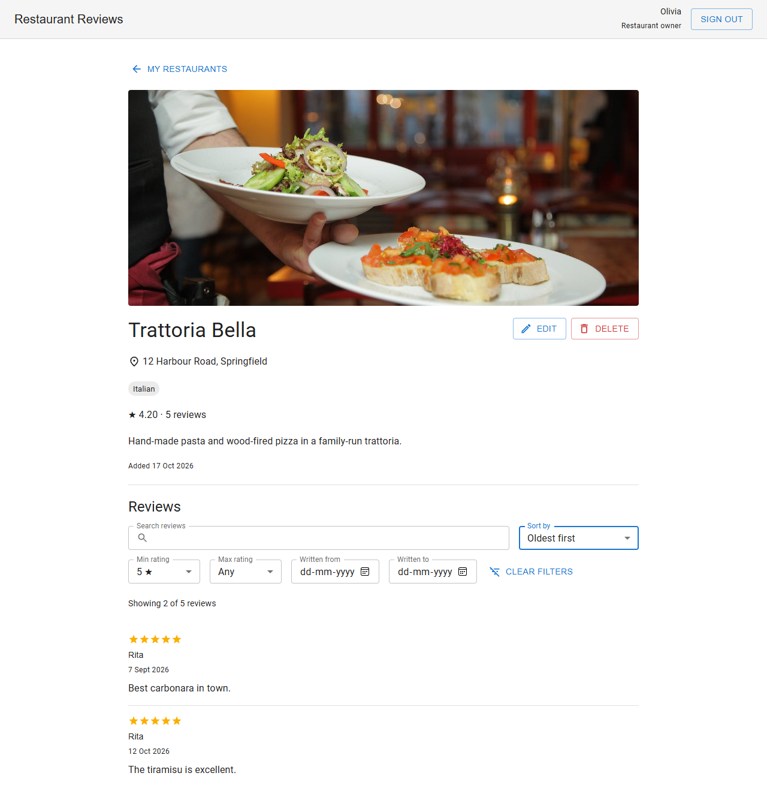 | 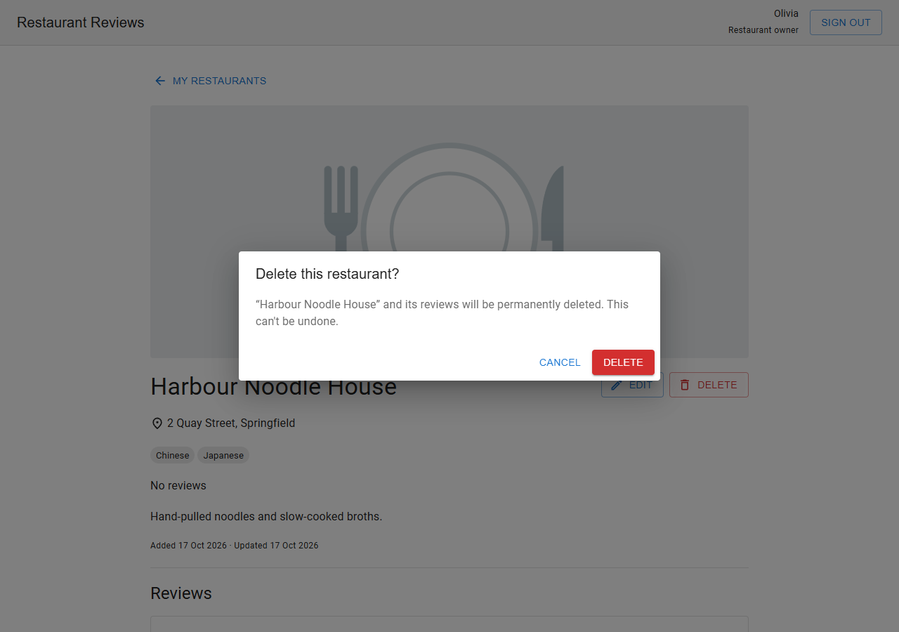 |

### Empty and error states

| No matching restaurants | Server unreachable, with retry |
|---|---|
| 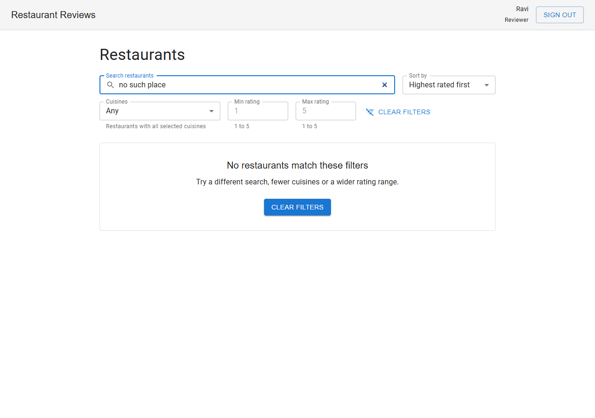 | 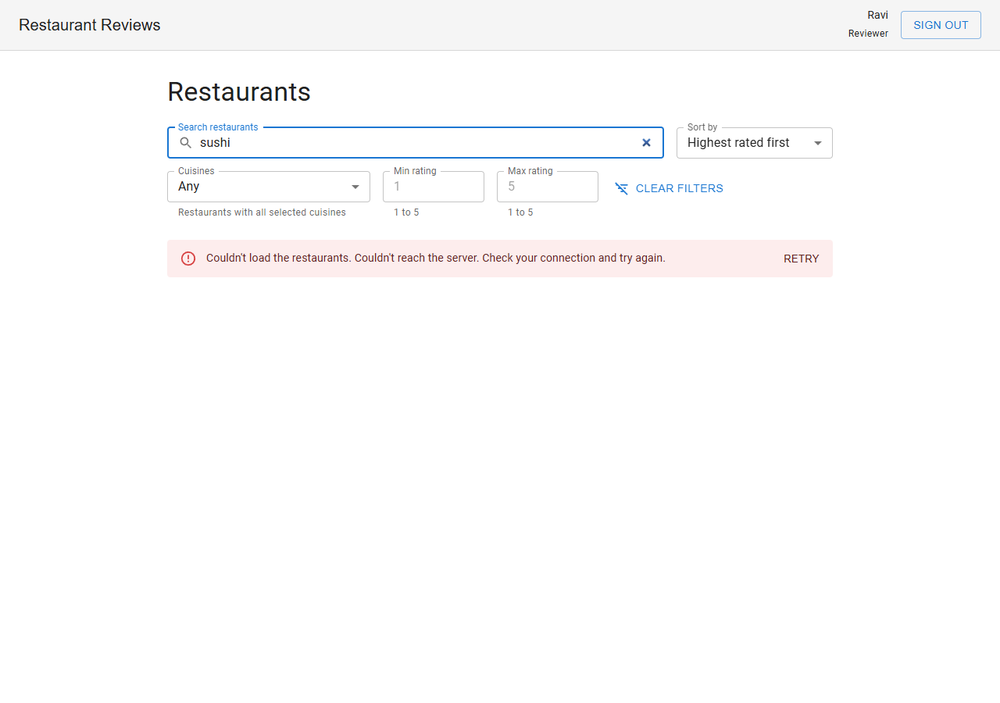 |

## Running locally

Needs the .NET 10 SDK, Node.js 20.19+ or 22.12+ (required by Vite 8) and Docker Desktop. From the repository root:

```powershell
dotnet tool restore                                                  # pinned dotnet-ef
npm ci --prefix client                                               # client packages, from the lockfile

docker compose up -d                                                 # PostgreSQL on localhost:5432
dotnet ef database update --project server/RestaurantReviews.Api     # apply migrations
dotnet run --project server/RestaurantReviews.Api                    # API on http://localhost:5218
```

In a second terminal:

```powershell
cd client
npm run dev                                                          # app on http://localhost:5173
```

Register an account from the sign-in page to get started; the database starts with the cuisine list only. `docker
compose down` stops the database and keeps its data; add `-v` to delete it.

### Demo data

To start over with sample data instead, stop the API and run:

```powershell
dotnet run --project server/RestaurantReviews.Api -- reset-db
```

This **deletes everything in the local database**, recreates the schema from the migrations, and adds 14 restaurants
(some with images, three without reviews) and 46 reviews written over the last three months. It prints the demo
accounts, which all use the password `demo-password`:

| Role | Email | Data |
|---|---|---|
| Restaurant owner | `olivia.owner@example.com` | 7 restaurants |
| Restaurant owner | `oscar.owner@example.com` | 7 restaurants |
| Reviewer | `rita.reviewer@example.com` | 23 reviews |
| Reviewer | `ravi.reviewer@example.com` | 23 reviews |

It also works on a database that doesn't exist yet, so it can replace the `dotnet ef database update` step above. It only
runs in the Development environment. The data is defined in `server/RestaurantReviews.Api/Seeding/DemoData.cs`.

## Deploying to AWS

The [Dockerfile](Dockerfile) builds one image containing the API, the React build it serves, and a migrations bundle.
It's set up to run on ECS Fargate in Sydney (`ap-southeast-2`), behind an Application Load Balancer and CloudFront,
which provides a free HTTPS address so no domain is needed. Data is in RDS PostgreSQL, and the sign-in keys are shared
through SSM Parameter Store, so redeploys don't sign users out. [deploy/README.md](deploy/README.md) has the
architecture diagram, the setup steps, and the task definition and IAM policies to use. It hasn't been deployed yet.
